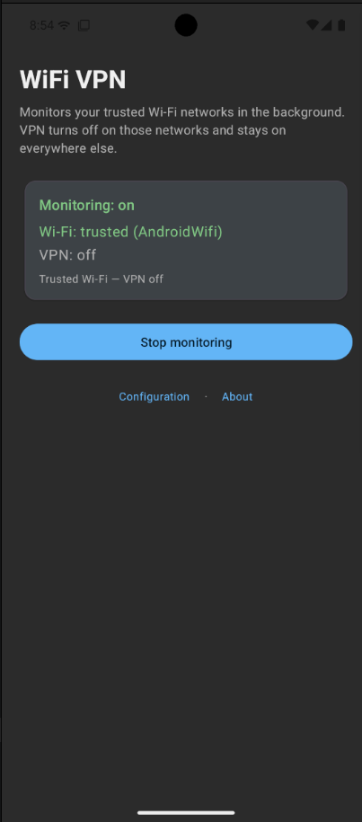
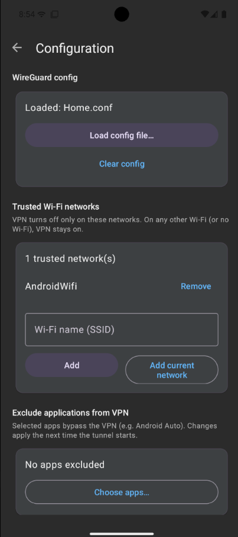
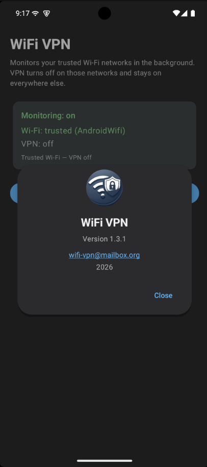
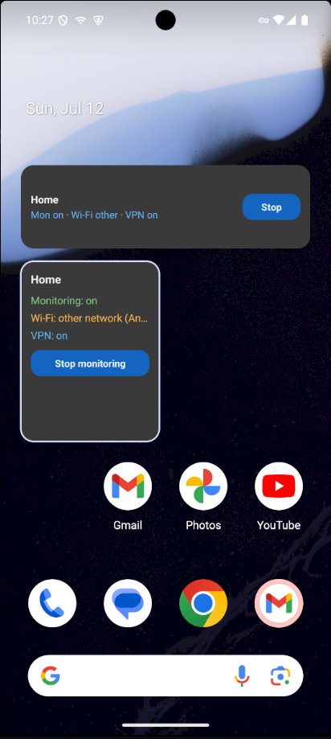

# WiFi VPN

**Version 1.4.13**

Android app that monitors **trusted Wi‑Fi networks** in the background and automatically controls a **WireGuard** tunnel:

| Network state | VPN action |
|---------------|------------|
| Connected to a **trusted** SSID | VPN **off** |
| Other Wi‑Fi, or no Wi‑Fi | VPN **on** |

Built with **Kotlin + Jetpack** (AGP 9 built-in Kotlin, Foreground Service, ConnectivityManager, DataStore, Material 3) and the official WireGuard tunnel library (`com.wireguard.android:tunnel`).

## Screenshots

| Main | Configuration | About |
|:----:|:-------------:|:-----:|
|  |  |  |

| Home-screen widgets (2×2 + 4×1) |
|:------------------------------:|
|  |

- **Main** — status card (monitoring, Wi‑Fi, VPN), VPN transfer stats while the tunnel is on, and start/stop control  
- **Configuration** — WireGuard config, trusted networks, exclusions, retries, permissions, and diagnostic log (section **(i)** help)  
- **About** — app name, version, contact email, and year  
- **Widgets** — 2×2 status card and 4×1 compact bar (tunnel name + **Monitoring: ON/OFF**, then **VPN: ON/OFF**, session totals + handshake age when VPN is on, Start/Stop)  


## Contact

- **Email:** [hummersoft@mailbox.org](mailto:hummersoft@mailbox.org)

## Download

Signed release APKs are published as **[GitHub Release assets](https://github.com/offsyanka99/WiFi-VPN/releases)** (not stored in git, to keep the repository small). Only the **current** release and up to **two previous** versions are kept for download.

| Version | Download |
|---------|----------|
| **Latest** | [Releases](https://github.com/offsyanka99/WiFi-VPN/releases/latest) |
| **1.4.13** | [v1.4.13](https://github.com/offsyanka99/WiFi-VPN/releases/tag/v1.4.13) |
| **1.4.12** | [v1.4.12](https://github.com/offsyanka99/WiFi-VPN/releases/tag/v1.4.12) |
| **1.4.10** | [v1.4.10](https://github.com/offsyanka99/WiFi-VPN/releases/tag/v1.4.10) |

Install with:

```bash
# After downloading the APK from the GitHub release page:
adb install -r wifi-vpn-1.4.13-release.apk
```

## Changelog

Release history is in [CHANGELOG.md](CHANGELOG.md). The current app version is **1.4.13**.

## Branches

| Branch | Purpose |
|--------|---------|
| **`release/1.0`** | Stable **v1.0** release line (bugfixes only if needed) |
| **`main`** | Ongoing development for future versions |

Download tags currently published: `v1.4.10` / `v1.4.12` / `v1.4.13`. Older notes are in [CHANGELOG.md](CHANGELOG.md).

## Features

- **Configuration** page for WireGuard config, trusted networks, app exclusions, VPN retries, VPN permission, battery optimization, unused-app setting, auto-start, location all the time, and diagnostic log
- **Trusted Wi‑Fi list** — add SSIDs manually or from the current network; VPN turns off only on those networks
- **Foreground service** with a persistent status notification while monitoring
- **WireGuard** tunnel via the userspace Go backend (`GoBackend$VpnService`)
- Load config from a `.conf` file (system file picker); **private keys in Android Keystore–backed encrypted storage** (not plain backup)
- **Exclude apps** from the VPN (e.g. Android Auto); multi-select list with search
- Configurable **VPN connect retries** (attempts + delay) with progress in the notification
- **Diagnostic log** (opt-in; network / VPN / tunnel / config events) with email share for troubleshooting; network names, access point addresses and the VPN server host are pseudonymised
- **Weekly permission check** with alert notification if critical permissions are disabled
- **Auto-start after reboot** (optional switch; requires config + at least one trusted SSID)
- **Location all the time** switch (optional) so trusted Wi‑Fi is recognised right after a reboot without opening the app
- **Battery optimization** exemption request and **Manage app if unused** shortcut (system settings)
- **Quick Settings tile** to start/stop monitoring (label = tunnel/config name when loaded)
- **VPN transfer stats** (main screen): live download/upload speed, session received/sent totals, last handshake age while the tunnel is up
- **Home-screen widgets** (2×2 status and 4×1 bar) to glance **Monitoring: ON/OFF**, Wi‑Fi, **VPN: ON/OFF**, session totals + handshake when VPN is on, and start/stop
- Location / nearby Wi‑Fi permission (needed to read SSIDs), and notification permission
- **Fail closed** — a Wi‑Fi network that cannot be identified is treated as untrusted (VPN on)
- **Screen off / locked** — monitor keeps a correct trusted/untrusted decision when the system redacts the SSID; VPN still turns on after leaving trusted Wi‑Fi

## Requirements

- Android 8.0+ (API 26)
- A WireGuard server and a client config (`[Interface]` / `[Peer]`)
- JDK 17, Android SDK **37** (`platforms;android-37.0`), Gradle **9.8.1** / AGP **9.4**

## Toolchain (this machine)

Installed under the user home (no root required):

| Component | Location |
|-----------|----------|
| JDK 17 (Temurin) | `~/.local/jdk/jdk-17` |
| Android SDK | `~/Android/Sdk` |
| Platform 37.0 / Build-Tools 36 / platform-tools | under SDK |
| `local.properties` | `sdk.dir=/home/yurik/Android/Sdk` |

Environment is appended to `~/.bashrc` (`JAVA_HOME`, `ANDROID_HOME`, `PATH`). Open a new terminal or `source ~/.bashrc`.

### Build from CLI

```bash
source ~/.bashrc
cd /path/to/WiFi-VPN
./gradlew assembleDebug
# APK: app/build/outputs/apk/debug/wifi-vpn-<version>-debug.apk
adb install -r app/build/outputs/apk/debug/wifi-vpn-1.4.13-debug.apk
```

### Unit tests

JVM unit tests (JUnit 4 + Robolectric) cover config helpers, SSID normalization,
policy snapshot equality, transfer formatting, intent auth, and WireGuard error
classification:

```bash
./gradlew :app:testDebugUnitTest
# Report: app/build/reports/tests/testDebugUnitTest/index.html
```

Release builds use signing from `keystore.properties` (see `app/build.gradle.kts`). Keystore files and that properties file are gitignored.

```bash
# Signed release APK (requires keystore.properties + keystore file)
./gradlew :app:assembleRelease

# Output:
#   app/build/outputs/apk/release/wifi-vpn-1.4.13-release.apk

adb install -r app/build/outputs/apk/release/wifi-vpn-1.4.13-release.apk

# Publish to GitHub (example) — do not commit the APK:
gh release create v1.4.13 \
  app/build/outputs/apk/release/wifi-vpn-1.4.13-release.apk \
  --title "1.4.13" \
  --notes "See CHANGELOG.md."
```

Current release: **1.4.13** (`versionCode` 29). Build outputs under `app/build/` are gitignored. APKs are distributed via **GitHub Releases**, not the git tree.

## Setup

1. Open this folder in Android Studio (optional) **or** use Gradle CLI above.
2. Sync Gradle and build the `app` module.
3. Install on a device with USB debugging (VPN APIs required; physical device recommended).
4. Open **Configuration** and tap **Load config file…** to pick a WireGuard `.conf`, for example:

```ini
[Interface]
PrivateKey = <your-client-private-key>
Address = 10.0.0.2/32
DNS = 1.1.1.1

[Peer]
PublicKey = <server-public-key>
AllowedIPs = 0.0.0.0/0, ::/0
Endpoint = vpn.example.com:51820
PersistentKeepalive = 25
```

5. Still in **Configuration**, add at least one **trusted Wi‑Fi** (type the SSID or use **Add current network**). Grant location / nearby Wi‑Fi permission if prompted.
6. Optionally choose **Exclude applications from VPN**.
7. Tap **Grant VPN permission** (system dialog). Enable **Battery optimization** exemption and leave **Manage app if unused** off for reliable background work. Optionally enable **Auto-start after reboot** — if you do, also turn on **Location all the time** so trusted Wi‑Fi is recognised right after a reboot.
8. On the main screen, tap **Start monitoring**. Optionally add the **WiFi VPN** Quick Settings tile (on Android 16, make the tile **wide** in QS edit if you want the tunnel name visible next to the icon).

## How it works

```
MainActivity / Quick Settings tile / BootReceiver
    │  start-stop; settings via ConfigurationActivity
    ▼
WifiMonitorService  (foreground + persistent notification)
    │  ConnectivityManager + trusted SSID list (DataStore)
    ▼
WifiConnectivityMonitor ──► connected? SSID? trusted?
    │
    ├── On trusted Wi‑Fi  → WireGuardManager.setTunnelDown()
    └── Other / no Wi‑Fi  → WireGuardManager.setTunnelUp(config, excludedApps)
                              (retries on failure)
```

Policy (see `WifiMonitorService`):

- Connected to a **trusted** SSID → VPN off  
- Any other Wi‑Fi, or no Wi‑Fi → VPN on  

WireGuard uses the official userspace Go backend (`GoBackend$VpnService`). Preferences (trusted SSIDs, exclusions, auto-start, monitoring flag, retries) live in **DataStore**; WireGuard private keys use **Keystore-backed** encrypted prefs.

SSID detection notes:

- The monitor service uses foreground-service types **`location|specialUse`** so SSID can still be read while the screen is off (while-in-use location permission).
- **After a reboot** (auto-start), Android grants a monitor started in the background no location access unless location is allowed **"All the time"**. Without it the SSID, BSSID and network id are all hidden until the app is opened once; opening it restores access for the rest of the session.
- If the OS redacts the SSID on lock, the last known name is reused **only** while still associated to the same network (`networkId` / BSSID, supplicant `COMPLETED`). Cache is dropped on disconnect or network change so VPN turns on promptly when you leave trusted Wi‑Fi.
- A remembered trusted network is recognised from memory only on a positive BSSID / `networkId` match. If nothing identifies the network, it is treated as **untrusted** (VPN on).

## Permissions

| Permission | Why |
|------------|-----|
| `INTERNET` | Tunnel traffic |
| `ACCESS_NETWORK_STATE` / `ACCESS_WIFI_STATE` | Detect Wi‑Fi |
| `ACCESS_FINE_LOCATION` / `ACCESS_COARSE_LOCATION` | Read current SSID (Android requirement) |
| `ACCESS_BACKGROUND_LOCATION` (optional) | "Allow all the time": read SSID after a reboot without opening the app |
| `NEARBY_WIFI_DEVICES` | Read SSID on Android 13+ without full location use |
| `ACCESS_LOCAL_NETWORK` | Android 17+: reach a VPN server on a private / CGNAT address |
| `FOREGROUND_SERVICE` / `FOREGROUND_SERVICE_LOCATION` / `FOREGROUND_SERVICE_SPECIAL_USE` | Keep monitor alive; location type so SSID remains readable with screen off |
| `POST_NOTIFICATIONS` | Status notification (Android 13+) |
| `RECEIVE_BOOT_COMPLETED` | Resume monitoring after reboot when auto-start is on |
| `WAKE_LOCK` | Reliable service work around sleep |
| `QUERY_ALL_PACKAGES` | List installed apps for VPN exclusion |
| `BIND_VPN_SERVICE` (system) | Create the VPN interface |
| `BIND_QUICK_SETTINGS_TILE` (system) | Quick Settings tile |

## Notes

- Battery optimizers can still kill background work; exclude the app if needed.
- Only one VPN can be active on Android; another VPN app will conflict.
- `AllowedIPs = 0.0.0.0/0` routes all traffic through the tunnel when VPN is on.
- SSID reading often needs **location services enabled** on the device, not only the runtime permission.
- Test by leaving a trusted home Wi‑Fi (or turning Wi‑Fi off on mobile data) and watching the notification switch to “Other Wi‑Fi — VPN active” or “No Wi‑Fi — VPN active”.
- Changes to excluded apps apply the **next** time the tunnel starts.
- Diagnostic log does not include WireGuard private keys or full tunnel config; network names, access point addresses and the VPN server host appear only as per-device codes.
- Location is used only to read the Wi‑Fi name. Your position is never stored, logged or sent.

## License

Use freely for personal projects. WireGuard is a registered trademark of Jason A. Donenfeld.
